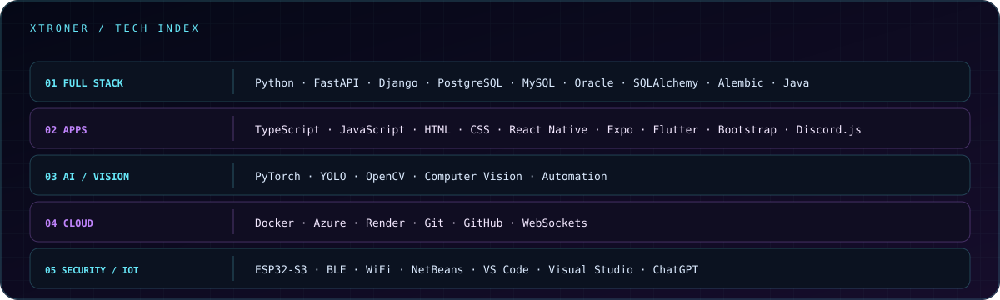

 

&nbsp;&nbsp;&nbsp;
&nbsp;&nbsp;&nbsp;

<code>CYBERSECURITY</code>&nbsp;&nbsp; <code>FULL STACK JR</code>&nbsp;&nbsp; <code>AI</code>&nbsp;&nbsp; <code>PROJECT MANAGEMENT</code>

## TECH STACK

  
## GITHUB ACTIVITY

 

